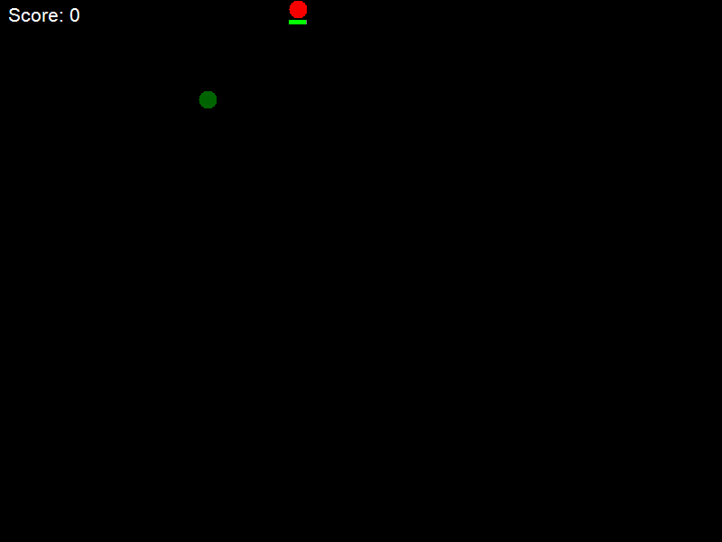
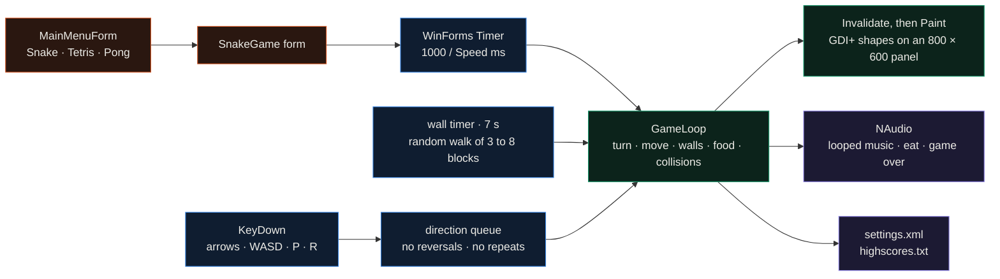
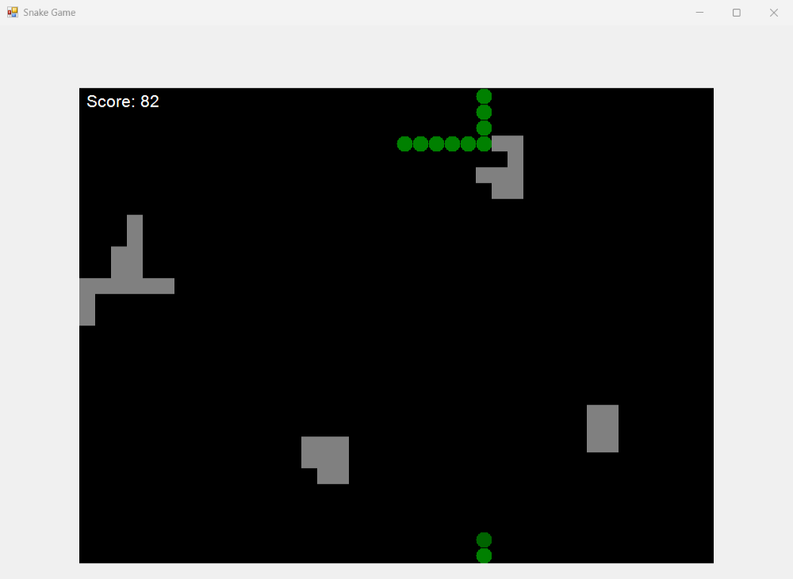
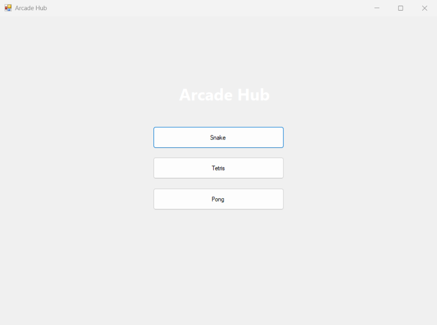

<div align="center">

# ArcadeHub

**An arcade launcher written from scratch in C# and Windows Forms, with one finished game: Snake on a timer-driven loop with GDI+ drawing, spawning walls, timed food and NAudio sound.**




</div>

This is an experiment and isn't finished: only one of the three games exists, and the engine code still lives inside the Snake game (see Limitations).
The idea was a game engine with no engine underneath: no Unity or MonoGame, only a WinForms timer for the loop, a
panel's Paint event for rendering, key events for input and NAudio for sound. The launcher lists Snake, Tetris and
Pong. Snake is complete; Tetris and Pong are placeholders.

---

## How it works



**Loop.** `gameTimer` fires every `1000 / Speed` ms; with the default speed of 10 that is 10 ticks per second. Each
tick applies at most one queued turn, moves the snake one cell, ages the walls, counts down the food timer, checks
collisions and invalidates the panel.

**Input.** Key presses don't change direction directly. Arrows or WASD are mapped to a direction, reversals and
duplicates are dropped, and the rest go into a queue that the loop drains one per tick. Two quick presses inside one
tick (up, then left) therefore both happen, on consecutive ticks, instead of the second overwriting the first. P
pauses the timers and the music, R resets the round.

**World.** The board is a 40 × 30 grid of 20 px cells and the edges wrap. The snake is a list of cells; eating adds a
segment where the tail just was. Food lives for 100 ticks and is worth `remaining / 100 × 10` points, so a quick catch
scores up to 10; the next food appears 2 seconds later. Every 7 seconds a wall of 3 to 8 connected blocks grows by a
random walk from a random cell, and is discarded if it would overlap the snake, the food or another wall. A new wall
flashes yellow and is harmless for 30 ticks, then turns grey and ends the game on contact, as does running into
yourself.

**Rendering.** The Paint handler redraws everything each tick with GDI+: walls as squares, the snake as circles with a
darker head, the food as a red circle that fades as its timer runs down with a small countdown bar under it, and the
score in the corner.

**State and sound.** Speed and cell size load from `settings.xml` through `XmlSerializer` (a default file is written
on first run) and the top 10 scores go to `highscores.txt`. Background music loops through a small `LoopStream`
wrapper around NAudio's `WaveStream`; the eat and game-over sounds get their own `WaveOutEvent` players.

 

The GIF is 300 consecutive ticks of the real game, 30 seconds at the default speed, saved with the panel's
`DrawToBitmap` after every tick. To get hands-free footage, a small script outside the repo steered the snake by
pushing directions into the same queue the keyboard handler fills; spawning, timing, scoring and drawing are all the
game's own code. In that run the snake reached 11 segments and 82 points while 5 walls spawned.

## Quickstart

Windows only. The project uses `packages.config`, so restore with `nuget.exe` (or open the solution in Visual
Studio, which restores on build):

```bash
nuget restore ArcadeHub/ArcadeHub.sln
dotnet build ArcadeHub/ArcadeHub.sln -c Release
ArcadeHub/ArcadeHub/bin/Release/ArcadeHub.exe
```

## Repository map

```text
ArcadeHub/ArcadeHub/
  Program.cs                    entry point, opens the menu
  MainMenu/                     launcher form: Snake, Tetris, Pong
  Games/SnakeGame/SnakeGame.cs  loop, input queue, walls, food timer, collisions, drawing, sound
  Models/                       Circle (grid cell), Wall, Settings (XML), HighScores (top 10)
  Utilities/LoopStream.cs       NAudio stream that loops the background track
  Resources/Sounds/             background, eat and game-over WAVs (copied next to the exe)
  Resources/Images/             sprite PNGs, embedded but not drawn yet
```

## Limitations

- Only Snake exists. The Tetris and Pong buttons show a "not implemented yet" message.
- The engine parts aren't separated yet. Loop, input, collisions and drawing all live in `SnakeGame.cs`, and the
  shared helpers (`InputHandler`, `GraphicsHelper`, `DoubleBufferedPanel`) are unused, so the board is a plain
  `Panel` without double buffering.
- The sprites in `Resources/Images` are embedded but the game draws plain shapes. The menu's white title was meant for
  a background image that is commented out, so it barely shows on the grey form.
- Every error path, and the "Press any key to start" prompt, is a modal message box.

## License

MIT
